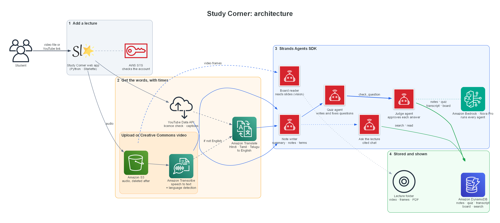

# Study Corner

**Watch less. Learn more.**

Study Corner turns a recorded lecture, uploaded or pasted as a YouTube link,
into **a summary, full notes, key terms, a checked quiz and a chat that
answers only from what the teacher said**. Every point links to the second of
the video where it was said. Lectures in Hindi, Tamil or Telugu come out as
English notes.

Built with the [Strands Agents SDK](https://strandsagents.com) on AWS:
Amazon Bedrock (Nova Pro), Amazon Transcribe, Amazon Translate, Amazon
DynamoDB and Amazon S3.

### At a glance

| | |
|---|---|
| **In** | A video or audio file, or any YouTube link |
| **Out** | Summary and key points · full notes in chapters · key terms · what was on the board · a quiz where every answer is proven by a quote · "Ask the lecture" chat · Show notes page · PDF |
| **Trust** | Code checks every quiz quote against the transcript before a judge agent approves it; chat answers may only cite times the tools actually returned, and may not show code that wasn't on screen |
| **Agents** | Board reader, note writer, quiz agent (tool loop), judge (agent as a tool), chat agent: all Strands |
| **Stored in** | Amazon DynamoDB: lectures, notes, quiz, transcript lines, board readings; searchable from the home page |

### Live demo

**<http://54.225.36.174>** (Amazon EC2, us-east-1)

Everything is open: upload a video, paste a YouTube link, or open the
finished lectures (notes, quiz, board, chat, Show notes, PDF and search).
YouTube blocks caption requests from AWS servers, so on the live site
standard-licence YouTube links ask for a pasted transcript; this works
automatically when you run it on your own computer.

### Quick start

```powershell
python -m venv .venv
.\.venv\Scripts\python.exe -m pip install -r requirements.txt
$env:LECTURE_AWS_PROFILE = "my-profile"
.\.venv\Scripts\python.exe -m lecture_agent.web       # http://127.0.0.1:8000
```

For YouTube links, put `YOUTUBE_API_KEY=...` in a `.env` file (git-ignored).
Details are in [Setup](#setup) and [Web app](#web-app-upload-a-recorded-lecture).

### Three ways in

| Input | How the words are found | Board and slides |
|---|---|---|
| Upload a file | Amazon Transcribe (language detected; non-English translated with Amazon Translate) | read by the board reader agent |
| YouTube link, Creative Commons | downloaded, then the same as an upload | read |
| Any other YouTube link | never downloaded: plays in YouTube's player; notes from YouTube's captions, translated if needed, or a pasted transcript | not read |

### Architecture



Drawn with the [`diagrams`](https://diagrams.mingrammer.com) library: `python docs/architecture.py`.

## Who it is for

Students who miss lectures because they work, care for family or travel far
to school, and students taught in a language they are still learning. A
missed hour of video becomes notes they can read in a few minutes, and a quiz
tells them which part to rewatch.

## How it works

```
lecture.mp4
  │
  ├─ listen ─ audio ─► Amazon Transcribe ─► timestamped lines  S1, S2, S3 …
  │
  ├─ look ── frames ─► slide-change detection (code) ─► board reader agent (vision)
  │
  ├─ notes ─ note writer agent ─► citations checked in code ─► coverage measured
  │
  ├─ quiz ── QUIZ AGENT (tool loop)
  │            tools: list_sections · read_transcript · search_transcript · check_question
  │                                                                        │
  │            check_question = code checks ─► duplicate check ─► JUDGE AGENT
  │                             (quote really in the cited lines?)   (agent used as a tool)
  │            steering: may not stop until the quiz is full
  │            hooks: per-tool and model-call budget · Limits: turns and tokens
  │
  └─ render ─► notes.md + lecture.json

then, in the web app:

  ASK THE LECTURE ─ chat agent with the same lecture tools
                    steering: every [mm:ss] cited must be a time a tool showed it
                    session manager: each student's conversation is saved
```

The order of the main steps is fixed in Python, because it is known in
advance. Inside the quiz and chat steps, the agents decide what to read and
when; deterministic code decides what they are allowed to keep.

## How it uses Strands

| Strands feature | Where | What it does here |
|---|---|---|
| `Agent` + structured output | `agents.py` | board reader (vision), note writer and judge each return a fixed schema |
| `@tool` | `tools.py`, `quiz_agent.py` | `search_transcript`, `read_transcript`, `list_sections`, `read_board`, `check_question`, all bound to one lecture |
| Agent as a tool | `check_question` | calls the judge agent, so the quiz agent cannot mark its own homework |
| Hooks | `guards.py` `BudgetHook` | caps calls per tool and model calls per request; a cancelled call tells the agent why |
| Hooks | `guards.py` `TraceHook` | records every tool call, shown in the UI and the quality report |
| Steering (`steer_after_model`) | `QuizCompletion` | blocks the quiz agent from finishing before enough questions have passed |
| Steering (`steer_after_model`) | `CitationCheck` | rejects a chat answer that cites a time no tool showed the agent, or a range it cannot verify |
| `Limits` | quiz and chat agents | hard ceiling on turns and tokens per run |
| `FileSessionManager` | `chat.py` | saves each student's conversation; follow-ups work after a restart |
| `SlidingWindowConversationManager` | `chat.py` | keeps long chats inside the context window |
| Strands Evals | `tools/evaluate.py` | `OutputEvaluator` and `TrajectoryEvaluator` score the chat agent |

## Grounding: what code checks

- **Notes cite transcript line numbers.** Citations to lines that don't exist
  are removed. A key point, term or example with no valid source is dropped.
- **Every quiz question carries an evidence quote.** `check_question` confirms
  in code that the quote is in the cited lines (exact, or a near match
  tolerating a dropped word, never a paraphrase), that a multiple-choice answer
  is one of the options, and that the question does not test a fact already
  used. Only then does the judge agent check the lines prove the answer. The
  quiz agent sees every failure reason and fixes the question or picks another
  fact.
- **Chat citations are verified.** Each `[03:14]` must be the start time of a
  transcript line, a board time or a section start that a tool returned in that
  request. Steering sends the agent back up to twice; anything still
  unverifiable is removed before the student sees it.

## What you get

`output/<lecture>/notes.md`:

- Summary
- Key points, each with ▶ the time it was said
- Full notes, section by section, in lecture order
- Key terms and worked examples (when the teacher gave them)
- What was on the board, read from the video
- Quiz, then an answer key with the teacher's own words and "rewatch from 03:14"
- A quality report: coverage, checks passed, questions rewritten or dropped

`output/<lecture>/lecture.json` contains the same data for other tools. In the
web app, use **Show notes** or **Download PDF** instead (see below).

## Setup

Python 3.10+. ffmpeg comes bundled through `imageio-ffmpeg`.

```powershell
python -m venv .venv
.\.venv\Scripts\python.exe -m pip install -r requirements.txt
```

AWS needs Bedrock (model `us.amazon.nova-pro-v1:0` by default), Transcribe
and S3 in `us-east-1`.

```powershell
$env:LECTURE_AWS_PROFILE = "my-profile"   # recommended: pins the account
```

Set a profile explicitly. Without one, boto3 uses whatever credentials are
active, and an IDE may have exported keys for a different account. The CLI
prints the account it found and **asks before making any paid call**.

| Variable | Default | Meaning |
|---|---|---|
| `LECTURE_AWS_PROFILE` | none | named AWS profile to use |
| `LECTURE_AWS_REGION` | `us-east-1` | region |
| `LECTURE_MODEL_ID` | `us.amazon.nova-pro-v1:0` | Bedrock model; must accept images |
| `LECTURE_MAX_TOKENS` | `8000` | output limit per model call |
| `LECTURE_S3_BUCKET` | `lecture-notes-agent-<account>-<region>` | where audio is uploaded for Transcribe; created if missing |

## Web app: upload a recorded lecture

```powershell
$env:LECTURE_AWS_PROFILE = "my-profile"
.\.venv\Scripts\python.exe -m lecture_agent.web
```

Open <http://127.0.0.1:8000>, choose or drag in a video or audio file (MP4,
MOV, WEBM, MKV, MP3, WAV, M4A, up to 2 GB), choose how many quiz questions you
want, and press **Make my notes**. The web app is for English lectures: it
transcribes English and writes the notes, quiz and chat in English. (The
command line still has `--language` and `--notes-language`.) Each upload makes paid Transcribe and Bedrock calls on
the AWS account the server prints when it starts.

While a job runs, the page shows each step with its time, a count of verified
quiz questions, and a live activity feed. When it finishes, the video sits
next to a chapter list and a timeline, with the notes in tabs: Summary and key
points, Full notes, Key terms, Board (each slide image with its text), an
interactive Quiz, **Ask**, and a Quality report. Every ▶ time jumps the video
to that moment, and a wrong quiz answer offers "Rewatch from 00:40". Keys:
`1`–`7` switch tabs, `K` plays or pauses, `/` jumps to Ask. The moon/sun
button switches between dark and light mode, and the choice is remembered.

**Show notes** (next to the title) opens the whole set of notes and the quiz as
one readable page with a contents list, and buttons to copy all the text or
print it. **Download PDF** gives the same content as a PDF: notes first, then
the quiz on its own page, then the answer key. The PDF is built the first time
it is asked for and reused after that.

Models nearly always put the right answer first, so the quiz moves it to a
different letter in each question (the order is fixed per quiz).

**Ask** is a chat that answers only from this lecture: "where does carbon
dioxide get in?" → "through tiny holes called stomata ▶ 00:18". It shows which
tools it used, refuses questions the lecture doesn't cover, and remembers the
conversation, so "and where does the water come from?" works. Each browser
gets its own conversation; add `?student=<id>` to the page address to reopen
one on another device. Every question is a paid model call.

Jobs run one at a time so uploads queue instead of multiplying the spend.
Each job is kept in `output/web/<job id>/` and stays listed after a restart.

### From a YouTube link

The **YouTube link** tab takes a video address instead of a file. As you
paste, Study Corner looks the video up with the YouTube Data API and shows its
title, channel, length and licence. Only videos the creator published under
YouTube's **Creative Commons (CC BY)** licence are accepted, because that
licence lets anyone reuse the video. Standard-licence videos are refused with
the reason, and you can upload your own copy instead if you have the right
to. The licence is checked again from the video page just before download.
Live streams, videos over 120 minutes, and videos whose creator set a spoken
language other than English are refused too.

The video is downloaded at up to 720p with [yt-dlp](https://github.com/yt-dlp/yt-dlp),
then goes through the same steps as an upload. Every output (the lecture
page, Show notes and the PDF) credits the title, the channel, a link and the
licence. Pasting a link that was already made opens the existing notes, so
nothing is charged twice.

It needs a YouTube Data API v3 key in a `.env` file in the project folder
(git-ignored):

```
YOUTUBE_API_KEY=your-key
```

Each lookup uses 1 unit of the free 10,000-unit daily quota. The key is sent
in a request header, never in a URL, and is not shown in the page. Node.js
(or Deno) must be installed: yt-dlp needs a JavaScript runtime for YouTube.

Tested on ["Learn Python: Identifiers and Keywords (Lesson 2)"](https://www.youtube.com/watch?v=3tp32DBXE1g)
by Indently (CC BY, 4 min 4 s): 7.4 MB downloaded in about 12 s, then 37
transcript lines, 7 screens of code read, 4 chapters, 10 key points, 100% of
the lesson cited, and 8 of 8 quiz questions verified.

### Database: Amazon DynamoDB

Every lecture is stored in one DynamoDB table (`study-corner-lectures`,
on-demand billing, created on first start). Each lecture is one partition:

| Item (`sk`) | Holds |
|---|---|
| `META` | title, source (upload or YouTube), video link, channel, licence, length, transcript source, status, counts, folder |
| `NOTES` | summary, key points, sections, key terms, worked examples, quality metrics |
| `QUIZ#001`… | one item per quiz question: options, answer, explanation, the teacher's quote |
| `LINE#00001`… | one item per transcript line with its start and end time |
| `BOARD#00001`… | one item per board or slide reading |

An `INDEX` partition lists every lecture newest first with one Query. A
finished lecture is written by the worker; lectures made before the table
existed are copied in when the server starts. The lecture page, Show notes
and the PDF read from DynamoDB, with the local `lecture.json` as a fallback,
and a database problem never fails a lecture. Videos, frame pictures and
PDFs stay in the lecture folder (the table stores its path).

**Search** on the home page finds every lecture that mentions a word in its
transcript, board or title, and links to the moment it was said
(`/jobs/<id>?t=<seconds>`). It uses a filtered Scan, which is fine for a
class's lectures; a large library would move it to OpenSearch.

Settings: `LECTURE_DDB_TABLE` (table name), `LECTURE_DDB=off` (run without
DynamoDB). The AWS user needs `dynamodb:CreateTable`, `DescribeTable`,
`Query`, `Scan`, `PutItem`, `UpdateItem`, `DeleteItem` and
`BatchWriteItem` on that table.

### Deploying the demo server (EC2)

`deploy/` puts Study Corner on one Amazon EC2 server in demo mode:

| Script | Does |
|---|---|
| `deploy/check_access.py` | checks your AWS user can create everything (dry run, creates nothing) |
| `deploy/package.py` | uploads the committed code and the finished lectures to S3; stores the YouTube key and a demo passcode in SSM Parameter Store as SecureStrings |
| `deploy/launch.py` | creates an IAM role with only the permissions the app needs, a security group open on port 80 only (no SSH), and a t3.small Amazon Linux 2023 server that installs and runs the app as a systemd service |
| `deploy/update.py` | ships the latest commit to the server and restarts it |
| `deploy/remote.py "<cmd>"` | runs a command on the server through AWS Systems Manager |
| `deploy/passcode.py` | prints the demo passcode |
| `deploy/teardown.py --yes` | deletes the server, security group, role, parameters and S3 package (keeps DynamoDB) |

The live server runs fully open. An optional **demo mode** locks adding
lectures behind a passcode and caps chat: set `LECTURE_DEMO_PASSCODE` (or
`STUDY_CORNER_DEMO=1` in the server's service) and, optionally,
`LECTURE_CHAT_PER_VISITOR_PER_DAY` (20) and `LECTURE_CHAT_PER_DAY` (200). No
key or passcode is in the code, the package or the server's user data. Cost:
about $15 a month for the t3.small, plus its public IP and disk; stop it with
`teardown.py --yes`.

### Uploads in Hindi, Tamil or Telugu

Uploads no longer have to be in English. Amazon Transcribe identifies the
spoken language (English US/India/UK, Hindi, Tamil or Telugu; set
`LECTURE_LANGUAGE_OPTIONS` to change the list). A non-English lecture is
translated to English line by line with Amazon Translate, times unchanged,
and the original lines are kept in `segments.original.json`.

Nova Pro can't read Hindi script on slides reliably: asked to translate a
Hindi slide it invented "What is the capital of Madhya Pradesh?", and its
structured reply failed outright on screens full of Hindi
(`modelStreamErrorException`, about a minute per try). For non-English
lectures the board reader now replies in plain text and keeps only the
English letters, code, numbers and web addresses on screen; what the teacher
says in Hindi still reaches the notes through Transcribe and Translate.

Tested on ["How to contribute to Hindi Wikipedia"](https://commons.wikimedia.org/wiki/File:How_to_contribute_to_Hindi_Wikipedia.ogv)
(Subhashish Panigrahi and Noopur Raval, CC BY-SA 3.0, 4 min 58 s): detected
as hi-IN, 22 lines translated, 21 of 24 screens read with no failures,
5 chapters, 91% covered, 8 of 8 quiz questions verified, in 167 s after
transcription. An English clip still came back as en-US.

### YouTube videos that may not be downloaded

Most YouTube videos have the standard licence, so they are **never
downloaded**. Instead:

- The video plays from YouTube's own embedded player on the notes page.
  Chapters, ▶ times and the `K` key control that player.
- The notes are made from the video's **English captions**, the same timed
  text YouTube shows under "Show transcript", read with
  [youtube-transcript-api](https://github.com/jdepoix/youtube-transcript-api)
  (the approach used in the Smart-Podcast-Finder project). If YouTube only
  has captions in another language, it translates them to English when it
  can; if not, the video is refused.
- If the only captions are in another language that YouTube can't translate
  (common for Hindi auto-captions), each timed line is translated to English
  with **Amazon Translate** (`lecture_agent/translate.py`). Times stay the
  same, so chapters, ▶ links and quiz checks all work on the English lines.
  Pasted transcripts in Hindi, Tamil, Telugu and other Indian scripts are
  translated the same way. Tested on a 15:38 Hindi video (Prashant Kirad,
  "Complete AI Masterclass for Students"): 122 lines, 15,810 characters
  translated in 9 s, then 6 chapters, 99% coverage, 10 of 10 quiz questions
  verified, and the chat answered "What does RCTO stand for?" with ▶ 04:29.
- If YouTube doesn't share the captions, the page asks the student to paste
  the transcript (with its times) from "Show transcript".
- Amazon Transcribe isn't used, so it is cheaper and faster: a 5-minute video
  took 60 s. The board and slides aren't read, so there's no Board tab.
- The credit says the video belongs to its creator and wasn't downloaded.

Tested on ["Learn Python for loops in 5 minutes!"](https://www.youtube.com/watch?v=KWgYha0clzw)
by Bro Code (standard licence): 25 timed lines from the auto-generated
captions, 5 chapters with their own times, 8 of 8 quiz questions verified,
no video or audio saved.

The chat then answered "How do I count backwards?" with
`reversed(range(10, 0))`, code the teacher never showed (it loops zero times).
The citation check now also rejects code in an answer unless the board
reader saw it on screen, and any sentence still showing unchecked code is
removed before the student sees it. The next answer explained it in words
with ▶ 01:55.

This lesson found two more problems, now fixed:

- **Two chapters at 00:00.** Amazon Transcribe's sentence list came back as
  13 lines for 4 minutes of unscripted speech, some 25 s long, so two chapters
  and two key points shared one start time. Lines are now built from the
  word timings, ending at a sentence end, or at a comma after 7 seconds, and
  never longer than 15 seconds (37 lines for the same lesson).
- **Typed code wasn't "a new slide".** Typing in an editor changes under 1% of
  the screen, so only 3 of 24 frames passed the 2% change bar, and the Board
  tab showed 2 readings. A small change now also counts once 30 seconds have
  passed since the last kept frame: 9 frames kept, 7 with code.

The server listens on 127.0.0.1 only and has no login. Don't expose it to the
internet as it is: anyone who can reach it could run jobs on your AWS account.

## Command line

```powershell
.\.venv\Scripts\python.exe -m lecture_agent lecture.mp4 --questions 10
```

| Option | Meaning |
|---|---|
| `--language en-US` | spoken language for Transcribe (`en-IN`, `hi-IN`, … or `auto`) |
| `--notes-language English` | language to write notes and quiz in |
| `--frame-every 10` | seconds between sampled frames |
| `--no-board` | skip reading the board |
| `--no-judge` | skip the judge agent; code checks still run |
| `--transcript file.json` | use an existing Transcribe result |
| `-y` | do not ask before using the AWS account |

Transcription results are cached in the output folder, so a rerun does not pay
for Transcribe again.

## Sample lecture

```powershell
.\.venv\Scripts\python.exe tools\make_sample_lecture.py
```

Builds `data/sample/photosynthesis.mp4`: a 65-second, 5-slide lecture
narrated by the Windows built-in voice. Because every word and slide time is
known, results can be checked against `ground_truth.json`. It also writes
`transcript_synthetic.json`, a transcript in Transcribe's format built from the
known narration, for testing without AWS. It is synthetic, not real
Transcribe output.

## Results on the sample lecture

Real run with Amazon Transcribe and Amazon Nova Pro, checked against the known
ground truth:

| Check | Result |
|---|---|
| Transcribe | 150 of 150 words heard; the only differences are numbers written as digits ("six" → "6") and US spelling |
| Section timestamps vs real slide starts | all 5 within 0.1 s |
| Board reading vs real slide text | 5 of 5 slides read 100% correctly, including the equation |
| Notes coverage | 14 of 14 transcript segments cited |
| Quiz agent, 8 questions | 8 of 8 verified from 8 checks; 5 `read_transcript` calls |
| Quiz agent, 12 questions (more than this short lecture holds) | 12 of 12 from 15 checks: 3 repeats of an already-used fact rejected, the agent then found new facts |
| Full run | 80 s for the 65 s lecture, including transcription |
| Cleanup | audio deleted from S3 and Transcribe job removed after each run |

### Chat agent, measured with Strands Evals

`tools/evaluate.py`: 7 student questions, each scored by `OutputEvaluator`
(correct, grounded, cited, refuses off-topic) and `TrajectoryEvaluator` (looked
it up first).

| Result | Value |
|---|---|
| Evaluations passed | 14 of 14, overall score 0.99 |
| In-scope answers with a verified ▶ citation | 5 of 5 |
| Off-topic questions refused (history, and a nearby biology topic) | 2 of 2 |
| Answers that looked the lecture up before answering | 7 of 7 |
| Unverifiable citations removed in this run | 0 |

### Problems that real runs found, and the fixes

- **Reworded "quotes".** The model quoted the teacher as saying *"Chlorophyll
  traps the energy of sunlight"*; the teacher said *"It traps…"*. It passed as a
  near match, so the answer key now shows the transcript sentence, never the
  model's version.
- **The same fact asked twice.** "What three things do plants need?" and
  "Which is NOT a requirement?" were both proven by the same sentence. The
  duplicate check now compares evidence, not only wording.
- **Unverifiable citations.** The chat agent once cited a range,
  `[00:11-00:37]`. Steering now rejects any time format it cannot check.
- **Steering messages in the chat history.** Strands stores steering guidance
  in the conversation as a user message, so the student's history showed
  "You cited times without reading the lecture" as if they had typed it.
  Guidance is now tagged and filtered out.

The sample is clean, synthetic speech with typed slides. For a real recording,
see the next section.

## Demo lecture: a real Python lesson

The demo uses a real recorded lesson, not a generated one:
[“Exception Handling in Python with try-except”](https://commons.wikimedia.org/wiki/File:Exception_Handling_in_Python_with_try-except.webm)
by Adam Gaweda (NC State University, course CSC111), licensed
[CC BY 3.0](https://creativecommons.org/licenses/by/3.0/). It is 5 minutes 7
seconds: slides, then live coding in the Spyder editor, with the teacher on a
webcam in the corner. The video is not stored in this repository; download it
from the link above and upload it in the web app.

Real run with Amazon Transcribe and Amazon Nova Pro:

| Check | Result |
|---|---|
| Transcribe | 22 segments of natural, unscripted speech ("uh", "gonna", restarts) |
| Board reading | 31 frames sampled, 19 kept after change detection, all 19 read, including the code and the `ZeroDivisionError` tracebacks |
| Notes | 7 sections, 10 key points, 91% of the transcript cited |
| Quiz agent, 8 questions | 7 verified from 13 checks: 1 failed the code check and was fixed, 5 repeats of a saved fact rejected; the agent then stopped with 7 because the lesson holds few separate facts |
| Chat | "What does the except block do?" answered with ▶ 03:00 and ▶ 04:36; "What is the capital of France?" refused, pointing to the start of the lesson |
| Time | transcription 51 s; then 194 s to read the screen, write the notes and build the quiz, for the 307 s lesson |

Problems this real lesson found, and the fixes:

- **A broken model reply stopped the whole job.** Nova once streamed an
  invalid tool-use reply while reading a frame (`modelStreamErrorException`).
  The single-task agents now retry such passing errors twice, and if one frame
  still can't be read it is skipped and logged instead of failing the lecture.
- **A dangling sentence after removing a citation.** The chat answered
  "…which starts at [00:01]." with a time it had not looked up. Removing the
  time left "…which starts at." The words leading up to a removed time now go
  with it. The cleaned answer is also saved to the chat history, so reopening
  the chat never shows the unchecked time.

## Evaluate

```powershell
.\.venv\Scripts\python.exe -m pip install -r requirements-dev.txt
.\.venv\Scripts\python.exe tools\evaluate.py --job output\photosynthesis
```

The built-in cases are for the sample lecture. For another lecture, pass
`--cases cases.json` with your own questions and expected answers.

## Verified without AWS

- Slide detection finds all 5 sample slides at 2, 5 and 10 second sampling.
- The transcript parser reproduces all 15 narration sentences exactly, from
  both Transcribe formats.
- The quiz checks give the expected result on hand-made cases: exact quote,
  near match, invented quote, paraphrase, wrong segment, answer not an option,
  and the same fact reworded.
- Steering decisions were tested directly: the quiz agent is held back when
  the quiz is short, and a chat answer is rejected for an invented time, a
  range, or citing before reading.
- The Transcribe client was checked against stubbed AWS responses: it uploads,
  polls, downloads, and deletes the audio and the job on success and failure.

