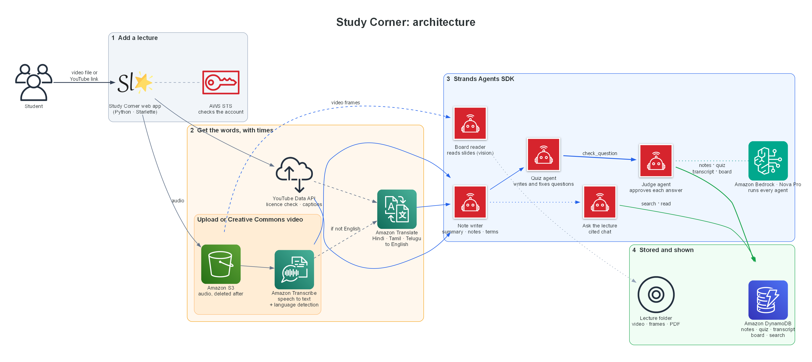

# Study Corner: notes you can trust from any lecture video, built with Strands Agents

*Watch less. Learn more.*

> **[IMAGE 1: the lecture page, with the video, chapters and the Summary tab]**

## The problem

Every student has missed a class. Maybe you were working, or ill, or the
lecture was in a language you are still learning. The recording is there,
but it is an hour long, and you have an exam on Friday.

AI can summarise a video, but students can't trust it. A summary that sounds
right and isn't is worse than no summary, especially in a quiz, where a wrong
"correct answer" teaches you the wrong thing.

So I set myself one rule for Study Corner: **every answer must be traceable
to the second of the video where the teacher said it**, and code, not the
model, decides whether it is.

## What it does

Paste a YouTube link or upload a recording. A few minutes later you get:

- a **summary** and **key points**, each with a ▶ time that jumps the video there
- **full notes** in chapters, with a timeline under the video
- **key terms** and worked examples
- **what was on the board**: every new slide, read from the video
- a **quiz** where every answer is proven by a quote from the lecture
- **Ask the lecture**: a chat that answers only from what the teacher said,
  cites times, and refuses everything else
- a clean **Show notes** page and a **PDF**
- **search** across every lecture you've added

Lectures in Hindi, Tamil or Telugu come out as English notes.

> **[IMAGE 2: the quiz, with a wrong answer and "Rewatch from 01:30"]**

## How it works



```
upload or YouTube link
  │
  ├─ listen ─ Amazon Transcribe (language detected) ─► Amazon Translate if not English
  │           or YouTube's captions for videos that may not be downloaded
  ├─ look ── slide-change detection (code) ─► board reader agent (Nova Pro, vision)
  ├─ notes ─ note writer agent ─► citations checked in code
  ├─ quiz ── quiz agent (tool loop) ─► check_question: code checks ─► judge agent
  ├─ store ─ Amazon DynamoDB: lecture, notes, quiz, transcript lines, board
  └─ chat ── chat agent with the same lecture tools, citations steered and verified
```

The order of the big steps is fixed in Python, because it never changes.
Inside the quiz and the chat, the agents decide what to read and when. Code
decides what they're allowed to keep.

## How it uses Strands Agents

| Strands feature | What it does in Study Corner |
|---|---|
| `Agent` + structured output | the board reader, note writer and judge each return a fixed schema |
| `@tool` | `search_transcript`, `read_transcript`, `list_sections`, `read_board`, `check_question`, all bound to one lecture |
| Agent as a tool | `check_question` calls a separate **judge agent**, so the quiz agent can't mark its own homework |
| Steering | `QuizCompletion` stops the quiz agent finishing early; `CitationCheck` rejects chat answers that cite a time no tool returned, or show code that wasn't on screen |
| Hooks | `BudgetHook` caps calls per tool and per request; `TraceHook` records every tool call for the Quality tab |
| `Limits` | a hard ceiling on turns and tokens for every run |
| Session manager | each student's chat is saved, so follow-up questions work after a restart |
| Strands Evals | `OutputEvaluator` and `TrajectoryEvaluator` score the chat agent (14 of 14 passed) |

### The quiz agent: write, check, fix

The quiz agent reads the lecture through tools, writes one question at a
time, and submits it to `check_question`. That tool runs plain code first:

1. Is the evidence quote really in the transcript lines it cites?
2. For multiple choice, is the answer exactly one of the options?
3. Does it test a fact we've already used?

Only then does the **judge agent** decide whether those lines prove the
answer. The quiz agent sees every failure reason and fixes the question.
On the Bro Code "for loops" video: 8 questions passed from 11 attempts, 1
failed the code check, and 1 was rejected by the judge.

## What real videos taught me

The best part of this project was running it on real lectures. Each one
broke something I hadn't thought of.

- **The model reworded the teacher.** It quoted *"Chlorophyll traps the
  energy of sunlight"*; the teacher said *"It traps…"*. The answer key now
  always shows the transcript sentence, never the model's version.
- **The right answer was always A.** In my first quiz, all 7 multiple-choice
  questions had the answer first. The answer now moves to a different letter
  in each question, with a fixed seed so the quiz is stable.
- **The chat invented code.** Asked how to count backwards, it answered
  `reversed(range(10, 0))`. The teacher never wrote that, and it loops zero
  times. Code in a chat answer is now only allowed if the board reader saw
  it on screen. Otherwise the agent explains in words and gives the time.
- **Typed code isn't "a new slide".** Typing in an editor changes under 1% of
  the screen, so a coding lesson gave only 2 board readings. Small changes now
  count once 30 seconds have passed: 7 readings for the same lesson.
- **Two chapters at 00:00.** Transcribe's sentences ran up to 25 seconds for
  unscripted speech. Lines are now rebuilt from word timings, at most 15
  seconds each.
- **Hindi slides made the model hallucinate.** Asked to translate a Hindi
  slide, Nova Pro produced *"What is the capital of Madhya Pradesh?"*, a
  sentence that was nowhere on screen. Its structured output also failed
  outright on screens full of Devanagari. For non-English lectures the board
  reader now keeps only what it reads reliably (English text, code, numbers,
  web addresses), and the Hindi speech still reaches the notes through
  Transcribe and Translate.

The lesson: **test on real data early, and let code check the model.**

## YouTube, done responsibly

Most students learn from YouTube, so Study Corner takes a link. But most
YouTube videos have the standard licence, which doesn't allow downloading.
So the app looks every link up with the **YouTube Data API** first:

| Video | What Study Corner does |
|---|---|
| Creative Commons | downloads it; every feature works, including the board |
| Standard licence | never downloads it. It plays in YouTube's own player on the page, and notes come from YouTube's captions |
| Captions only in Hindi | translated line by line with Amazon Translate, times kept |

Every page and PDF credits the creator and links to the original video.

> **[IMAGE 3: the YouTube tab, showing "Plays from YouTube · notes from its captions"]**

## Results on real lectures

| Lecture | Way in | Result |
|---|---|---|
| CSC111 *Exception Handling* (Adam Gaweda, CC BY), 5:07 | upload | 19 slides read, 91% of the lecture cited |
| *Learn Python: Identifiers and Keywords* (Indently, CC BY), 4:04 | YouTube, downloaded | 7 code screens read, 100% cited, 8/8 quiz |
| *Learn Python for loops in 5 minutes!* (Bro Code) | YouTube captions | 60 s, 5 chapters, 8/8 quiz, nothing downloaded |
| *Complete AI Masterclass for Students* (Prashant Kirad, Hindi), 15:38 | YouTube Hindi captions → Amazon Translate | 15,810 characters translated in 9 s, 99% cited, 10/10 quiz |
| *How to contribute to Hindi Wikipedia* (CC BY-SA), 4:58 | upload, Hindi speech | detected hi-IN, 5 chapters, 91% cited, 8/8 quiz |

Each lecture costs a few cents to tens of cents in Bedrock, Transcribe and
Translate calls. DynamoDB is on-demand, so it costs nothing when idle.

## Built with

Strands Agents SDK · Amazon Bedrock (Nova Pro) · Amazon Transcribe · Amazon
Translate · Amazon DynamoDB · Amazon S3 · YouTube Data API · Starlette ·
plain HTML, CSS and JavaScript, no frontend framework.

## What's next

- Deploy on Amazon Bedrock AgentCore with a login, so a whole class can use it
- Read Hindi slides with a model that handles Devanagari reliably
- Flashcards and spaced repetition from the verified quiz

## Try it

Code: **[GitHub link]**. The README has setup in four commands.

Study Corner started in the AWS *Strands Agents* workshop. Everything I
learned there (tools, agents as tools, steering, hooks, sessions) ended up
doing real work here.
